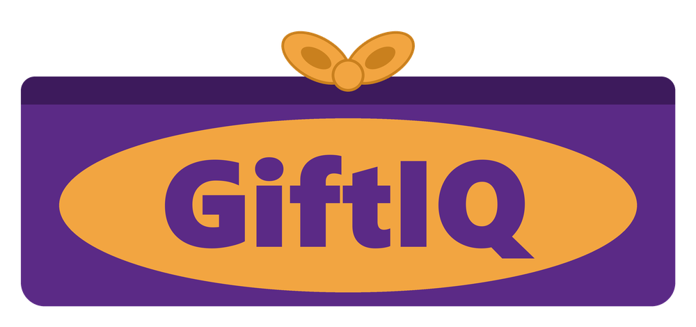
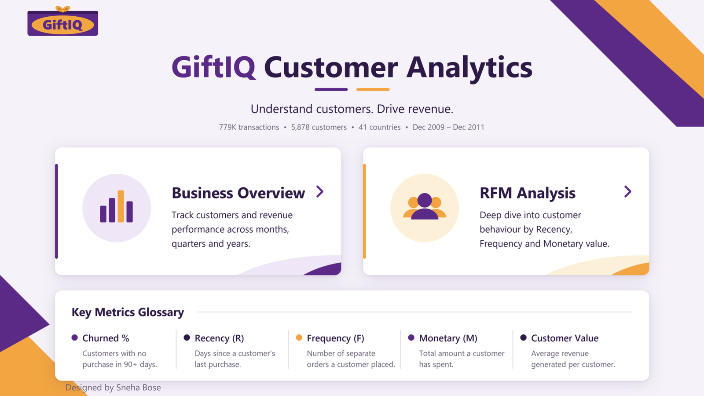
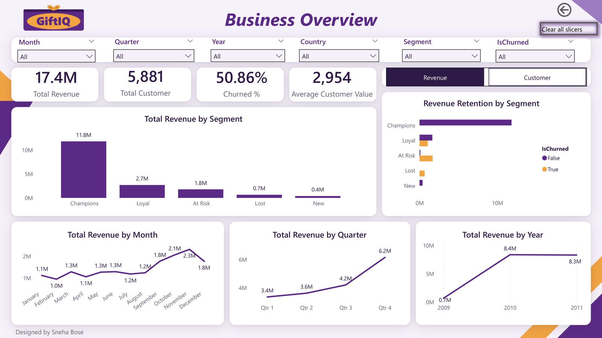
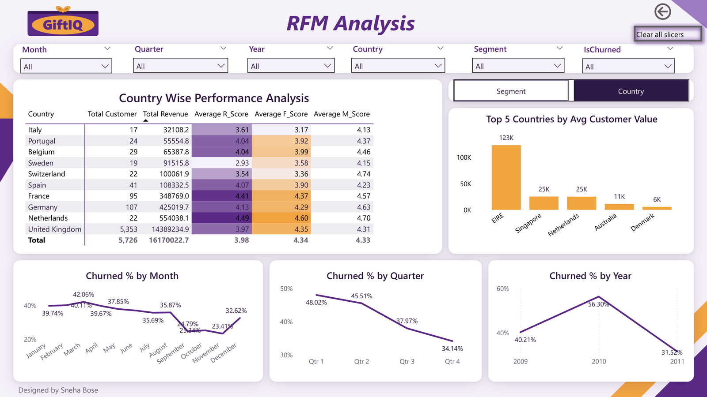

<p align="center">
  
</p>

<h1 align="center">GiftIQ – RFM Customer Segmentation</h1>

<p align="center">
  Customer segmentation and churn analysis for an online gift retailer, using <b>Python</b> and <b>Power BI</b>.
</p>

<p align="center">
  
  
  
</p>

---

## Business problem

An online gift retailer sells to thousands of customers but treats them all the same. The business wants to know:

1. **Who are our most valuable customers?**
2. **Which good customers are about to leave?**
3. **When does revenue come in, and from where?**

This project answers those questions with an **RFM (Recency, Frequency, Monetary)** model and an interactive 3-page Power BI dashboard.

## Key insights

| | Insight |
|---|---|
| 👑 | **Champions are 22% of customers but bring in 68% of revenue** ($11.8M of $17.4M). |
| ⚠️ | **$1.79M is at risk.** 1,208 At Risk customers have stopped buying recently. |
| 📉 | **50.86% of customers have churned** (no purchase in 90+ days). |
| 🎁 | **Q4 brings in 35% of yearly revenue.** Sales climb from September and peak in November. |
| 🌍 | **83% of revenue comes from the UK**, which leaves room to grow abroad. |

### Recommendations
- **Champions:** loyalty perks and early access to new collections.
- **At Risk:** personalised win-back offers before the Q4 gift season.
- **New:** a welcome series that pushes a second purchase.
- **Lost:** low-cost reactivation emails only.

## Dataset

- **Source:** [UCI Online Retail II](https://archive.ics.uci.edu/dataset/502/online+retail+ii), transactions from a UK-based online gift retailer
- **Period:** December 2009 to December 2011
- **Size after cleaning:** 779,495 invoice lines · 36,975 orders · 5,881 customers · 41 countries · $17.37M revenue

## Tools

| Tool | Used for |
|---|---|
| Python (Pandas, Matplotlib) | Cleaning, RFM calculation, scoring, segmentation, validation |
| Power Query | Data types and a date-only key column |
| Power BI + DAX | Star-schema model, measures, field parameters, interactive dashboard |
| Pillow (Python) | Generating the GiftIQ logo and dashboard backgrounds |

## Approach

```
Raw transactions ──► Clean (Python) ──► RFM per customer ──► Scores 1–5 ──► 5 segments + churn flag
                                                                                   │
                                     Power BI dashboard ◄── Sales.csv + Customers.csv (star schema)
```

1. **Clean:** keep rows with a customer ID and a positive quantity, then calculate `Revenue = Quantity × Price`.
2. **RFM:** for each customer, calculate days since last purchase (**R**), number of orders (**F**) and total spend (**M**).
3. **Score:** split customers into 5 equal groups per metric with `pd.qcut`. Recency is reversed, because recent is better.
4. **Segment:**

   | Segment | Rule | Customers | Revenue | % of revenue |
   |---|---|---:|---:|---:|
   | Champions | R ≥ 4, F ≥ 4, M ≥ 4 | 1,291 | $11.84M | 68.1% |
   | Loyal | R ≥ 3, F ≥ 3 | 1,416 | $2.70M | 15.5% |
   | At Risk | R ≤ 2 and F ≥ 3, or R = 3 and F ≤ 2 | 1,208 | $1.79M | 10.3% |
   | Lost | everything else | 1,524 | $0.65M | 3.8% |
   | New | R ≥ 4, F ≤ 2 | 442 | $0.39M | 2.3% |

5. **Churn:** a customer is churned if they haven't bought anything in more than 90 days.
6. **Model:** `Customers` (dimension) and `DateTable` connect one-to-many to `Sales` (fact).

## Dashboard

Features: synced slicers (Month, Quarter, Year, Country, Segment, IsChurned), field-parameter toggles, page-navigation buttons, a custom theme and custom backgrounds. The report is in [`dashboard/GiftIQ_RFM_Dashboard.pbix`](dashboard/GiftIQ_RFM_Dashboard.pbix), and there's a PDF version in [`dashboard/GiftIQ_RFM_Dashboard.pdf`](dashboard/GiftIQ_RFM_Dashboard.pdf).

### Home
Title, navigation cards to the two analysis pages, and a glossary of the key metrics.



### Business Overview
KPI cards (revenue, customers, churn %, average customer value), revenue by segment, revenue retention by segment with a Revenue/Customer toggle, and revenue by month, quarter and year.



### RFM Analysis
A performance table with average R, F and M scores and colour scales, a Segment/Country toggle for average customer value, and churn % by month, quarter and year.



Every column is described in [docs/Data_Dictionary.md](docs/Data_Dictionary.md).

## Repository structure

```
GiftIQ-RFM-Customer-Segmentation/
├── assets/                  logo, icon and page backgrounds
├── dashboard/               GiftIQ_RFM_Dashboard.pbix and the Power BI theme
├── data/
│   ├── processed/           Customers.csv, Sales.zip (unzip to get Sales.csv)
│   └── README.md            how to get the raw data
├── docs/                    data dictionary
├── notebooks/
│   └── 01_rfm_segmentation.ipynb
├── scripts/
│   ├── prepare_powerbi_data.py
│   └── design/              scripts that draw the logo and backgrounds
└── requirements.txt
```

## How to run

**View the dashboard:** download [`dashboard/GiftIQ_RFM_Dashboard.pbix`](dashboard/GiftIQ_RFM_Dashboard.pbix) and open it in [Power BI Desktop](https://www.microsoft.com/power-platform/products/power-bi/desktop) (free). The data is already inside the file.

**Run the Python part:**

```bash
git clone https://github.com/SnehaBong/GiftIQ-RFM-Customer-Segmentation.git
cd GiftIQ-RFM-Customer-Segmentation
pip install -r requirements.txt
```

**Option A – use the processed data:** unzip `data/processed/Sales.zip`, then open Power BI and load `Sales.csv` and `Customers.csv`.

**Option B – rebuild from the source file:** put `EcommerceDashboardData.xlsx` in `data/raw/` (see [data/README.md](data/README.md)), then run the notebook or:

```bash
python scripts/prepare_powerbi_data.py
```

In Power BI, import the theme with **View → Themes → Browse for themes → `dashboard/GiftIQ_Theme.json`**.

## What I learned

- Building an RFM model from raw transactions, and why scoring direction matters. An early version scored Frequency backwards and found only 26 Champions instead of 1,291.
- Why a star schema matters: scores stored once per customer don't get double-counted across purchase rows.
- Writing DAX with `DISTINCTCOUNT`, `CALCULATE`, `DIVIDE`, `AVERAGEX` and `SUMMARIZE`, and using field parameters for interactive toggles.
- Designing a consistent visual identity: theme, logo and backgrounds.

## Author

**Sneha Bose** · [GitHub](https://github.com/SnehaBong)
